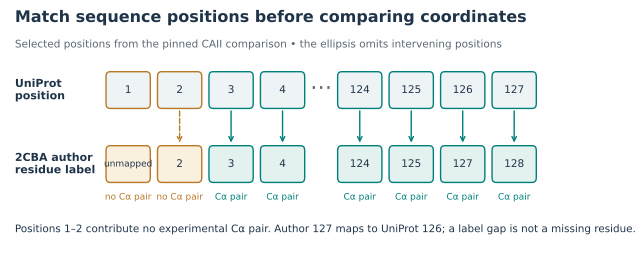
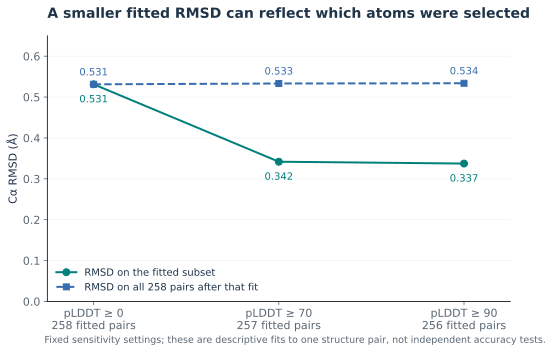
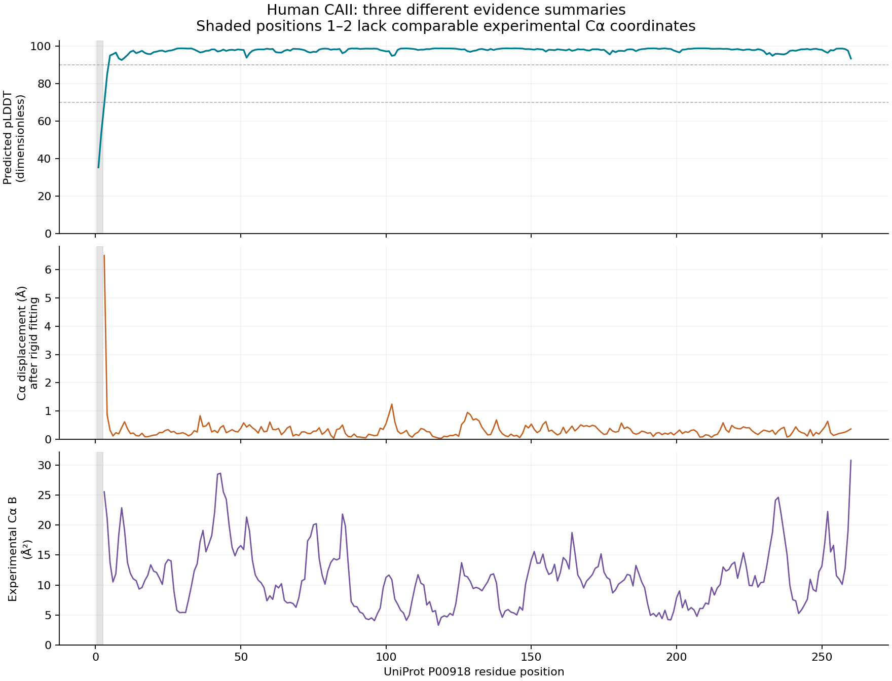

# Protein structure evidence

**How much does a predicted protein structure tell us when we also have an experimental model?** This example compares two models of human carbonic anhydrase II. It maps corresponding residues, aligns their backbones, and displays predicted confidence separately from experimental displacement parameters.

## Why this project

An attractive structural overlay can hide differences between two models. This example shows the residue correspondence, source records, and fitting choices behind the image. Start with the [project context](docs/project-context.md) or [biology guide](docs/biology-and-concepts.md).

This educational case study was developed with AI assistance and checked with executable examples. It is not a new structure determination or a functional validation study.

**Training or template overlap cannot be excluded:** 2CBA was available before AlphaFold2 training, and the training/template inputs for this prediction have not been audited. Root-mean-square deviation (RMSD) summarizes the distance between matched atoms as the square root of their mean squared distance. A small fitted RMSD here does not establish independent generalization.

## What it does

| Source | Selected evidence |
| --- | --- |
| [UniProt P00918](https://www.uniprot.org/uniprotkb/P00918/entry) | Canonical (reference) human carbonic anhydrase II (CAII) sequence, 260 amino-acid residues; sequence version 2. |
| [PDB 2CBA](https://www.rcsb.org/structure/2CBA) | Chain A, X-ray model at 1.54 ångströms (Å; $`1\,\text{Å} = 10^{-10}\,\mathrm{m}`$) resolution; no reported amino-acid mutations; zinc is the only nonwater ligand. |
| [AlphaFold DB P00918](https://alphafold.ebi.ac.uk/entry/P00918) | Pinned `AF-P00918-F1-model_v6`, generated 1 August 2025 by the AlphaFold Monomer v2.0 pipeline. |

The code maps depositor residue labels to the reference sequence using RCSB (Research Collaboratory for Structural Bioinformatics) metadata and SIFTS (Structure Integration with Function, Taxonomy and Sequences). It checks amino-acid identities, aligns corresponding alpha-carbon (Cα) coordinates to compare the backbones, and cross-checks the prediction's confidence column against the separate AlphaFold confidence file.

An optional export saves the transformed prediction for external inspection, with explicit transform conventions, source hashes, and a receipt.

Canonical positions 1–2 have no comparable experimental Cα coordinates. The Protein Data Bank (PDB) record declares an acetyl (ACE) cap instead of canonical Met1, and Ser2 is unmodeled. Later, author numbering jumps from 125 to 127 while canonical numbering remains continuous: author 127 maps to UniProt 126. An absent author number is not necessarily a missing amino acid.

## Quick start

Use Python 3.12 from the repository root:

```sh
python -m pip install -r requirements.txt
python analyze.py --output-dir reproduced-results
python -m unittest discover -s tests -v
```

All source snapshots are included; analysis runs offline after dependencies are installed. The command above writes `reproduced-results/`, leaving the recorded `results/` available for comparison. `make test` runs the same test command; `make demo` uses the default output directory and regenerates `results/`. The optional [retrieval script](scripts/fetch_data.py) accepts downloaded inputs only when their fingerprints match the recorded snapshot.

Git attributes preserve source and saved-bundle bytes across checkouts, including on Windows. Re-saving those inputs with different line endings can correctly trigger a fingerprint failure.

To inspect the fitted model in a molecular viewer, choose a new output directory:

```sh
python export_alignment.py --output-dir derived/inspection-001
python verify_alignment.py --bundle-dir derived/inspection-001
```

The export refuses an existing destination. Verification reads the bundle, checks its hashes against pinned inputs, recomputes the fit, and checks every transformed atom. It writes no changes to the bundle; use `--json` for a machine-readable report. Open `aligned_prediction.pdb` alongside `data/2cba.pdb` without applying another fit. See [the worked use case](docs/practical-use.md) for the exact contract and [the checked-in export example](examples/alignment/README.md).

## Example results

| Output | Purpose |
| --- | --- |
| [Report](results/report.md) / [summary JSON](results/summary.json) | Counts, fit settings, and descriptive results. |
| [Residue comparison](results/residue_comparison.csv) | All 260 canonical positions, missing Cα values, numbering, pLDDT, experimental B factors, and displacements. |
| [Fit sensitivity](results/fit_sensitivity.csv) | Fixed pLDDT cutoffs of 0, 70, and 90, with separate fit/evaluation denominators. |
| [Zinc geometry](results/zinc_geometry.csv) | Three experimental Zn–histidine atom distances; no predicted zinc is added. |
| [Evidence profiles](results/evidence_profiles.png) / [backbone overlay](results/backbone_overlay.png) | Distinct evidence panels and matched Cα traces. |
| [Exported model](examples/alignment/aligned_prediction.pdb), [transform](examples/alignment/transform.json), [receipt](examples/alignment/receipt.json) | Full predicted model in the experimental coordinate frame, plus reproducible fit selection and integrity metadata. |
| [Verification report](examples/verification/report.json) | Read-only check of the saved bundle against pinned inputs; includes fit counts, file hashes, and runtime-metadata limits. |

The default fit uses **258 Cα pairs**, with RMSD **0.531 Å**. The largest displacement is **6.499 Å** at canonical residue **3**, where predicted local distance difference test (pLDDT) confidence is **69.06** and experimental Cα occupancy is **0.50**. These observations describe the disagreement but do not establish its cause.

Figure 1 explains why residue mapping comes before the structural fit. The numbering gap is a label difference; the first two positions lack comparable experimental Cα coordinates.



**Figure 1. Match positions before comparing coordinates.** This original schematic uses selected rows from [the residue comparison](results/residue_comparison.csv). It is a numbering diagram, not a drawing of the protein fold. The omitted positions are indicated by an ellipsis; the complete table retains all 260 positions.

Figure 2 shows a second distinction: lowering the RMSD on a selected subset does not necessarily lower the disagreement over all matched positions.



**Figure 2. Atom selection changes the reported RMSD.** Values come from [the three fixed sensitivity settings](results/fit_sensitivity.csv). Circles summarize the fitted subset; squares evaluate all 258 pairs after the same fit. These are descriptive analyses of one structure pair, not independent tests of prediction accuracy. The [figure builder](tools/build_documentation_figures.py) recreates Figures 1–2 without refitting a structure.

Table 1 distinguishes the quantities in the figures by their units, denominators and interpretation limits.

**Table 1. What the structural quantities mean.** Definitions and source documentation are expanded in the [biology guide](docs/biology-and-concepts.md) and [methods](docs/methods.md).

| Quantity | Unit and denominator | Useful reading | Limit |
| --- | --- | --- | --- |
| pLDDT | Dimensionless, one value per predicted residue | Local prediction confidence | Not a measured error or activity score |
| Experimental Cα B factor | Ų, one selected atom per observed residue | Displacement parameter in the crystallographic model | Not the same scale as pLDDT |
| Cα displacement | Å, one mapped atom pair after the fit | Where the two coordinate models differ | Does not establish the cause of disagreement |
| RMSD | Å, averaged over a declared set of atom pairs | A summary of geometric agreement for that set | Depends on mapping, fitting, and selection |

Figure 3 keeps these evidence channels in separate panels rather than combining them into a single quality score.



**Figure 3. Separate evidence profiles along the sequence.** The existing analysis plots pLDDT, experimental B factors, and fitted displacement from [the same residue table](results/residue_comparison.csv). Missing experimental coordinates remain missing; none of these panels measures protein activity.

## Practical use and limitations

Use this example to learn residue mapping, numerical geometry, and the limits of structural comparisons. The code accepts only this pinned case, not arbitrary uploaded proteins.

- pLDDT is predicted local confidence; experimental B factors, atomic displacement parameters in Ų, are different quantities with different units. The shared PDB column does not make them comparable scores.
- RMSD depends on the mapped atoms and fitted subset. Changing a cutoff is not evidence of improved prediction accuracy.
- Cα agreement does not validate side chains, waters, dynamics, catalytic activity, or binding affinity.
- The experimental model contains zinc; this AlphaFold monomer file does not. The export neither adds a cofactor nor repairs a structure.
- Exported PDB coordinates are rounded to three decimals. Unit-cell and coordinate-frame placeholders are removed; the export is for inspection, not crystallographic refinement or deposition.
- A verified bundle is computationally consistent with the pinned case; it does not authenticate an author or establish biological validity. Runtime metadata is reported separately; `--strict-runtime` can require version agreement.

## Documentation

The [21 October 2026 maintenance and scientific review](docs/review-2026-10-21.md) records the latest checks and their limits. Earlier review records remain available below.

[Glossary](docs/glossary.md) · [Assumptions and justifications](docs/assumptions.md) · [Reference audit](docs/reference-audit.json) · [Review record, 20 October 2026](docs/review-2026-10-20.md)

| Guide | What it covers |
| --- | --- |
| [Project context](docs/project-context.md) | Background, purpose, and themes. |
| [Biology and concepts](docs/biology-and-concepts.md) | CAII, catalysis, structures, confidence, and interpretation. |
| [Methods](docs/methods.md) | Mapping, fit, atom-selection, and export assumptions. |
| [References](docs/references.md) | Scientific and official sources. |
| [Data provenance and reuse](data/README.md) / [manifest](data/provenance.json) | Pinned inputs, hashes, attribution, and terms. |
| [Practical use](docs/practical-use.md) | Input/output contract, worked example, failure behavior, and next improvements. |
| [Literature review](docs/literature-review.md) / [search log](docs/search-log.json) | Bounded review, screening decisions, and source-to-code consequences. |

## Development and reuse

The 38 tests check mapping, geometry, confidence semantics, failure cases, deterministic outputs, exported coordinates, and altered bundles. Two tests specifically require symbolic-link creation and are reported as skipped when the account or filesystem cannot create links; unrelated checks still run. Linux CI requires those two tests to run, then runs the analysis, export, and verification on Python 3.12. See [contributing](CONTRIBUTING.md) for development expectations.

Code is MIT licensed. Source data and derived model coordinates retain their [reuse conditions and attribution](data/README.md). No code was copied from related tools.
